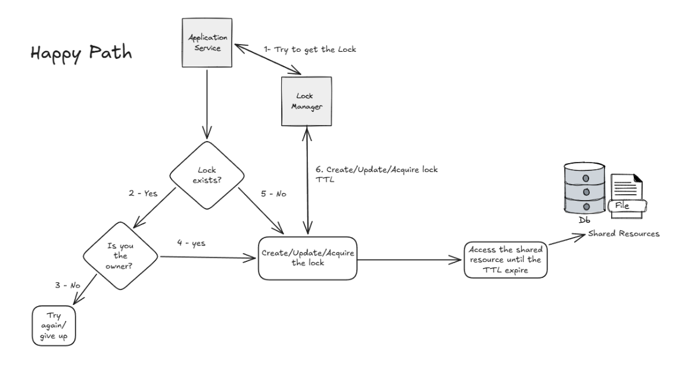
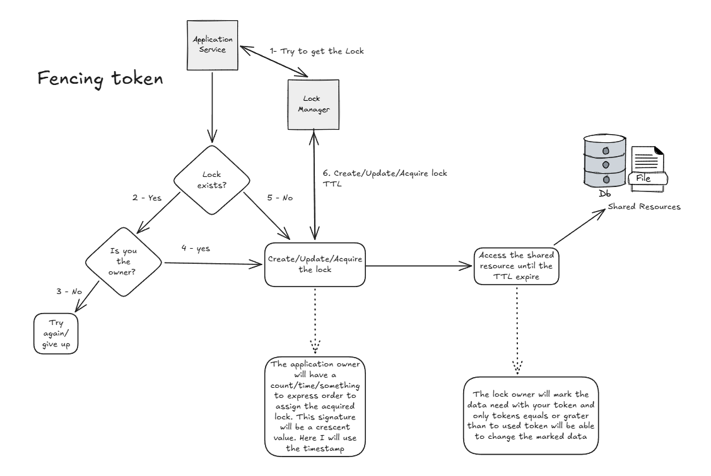

# Distributed Locks: A Case Study

## Introduction

In a distributed system, a microservice architecture, or any scenario where multiple processes need to access the same resource, consistency, predictability, and availability are essential. We must ensure that race conditions, data overwrites, and duplicated operations do not affect the system.

In a single process, when multiple threads need to modify the same document, the common solution is to lock it so that only one thread can access the resource at a time. This avoids race conditions and inconsistent data.

In a distributed system the logic is the same: we need a way to synchronize access, just as a mutex does in a single-process environment.

This is where the Distributed Lock strategy comes in. In simple terms, it lets only one process operate on a shared resource at a time: one actor can change the shared resource per time slot.

Of course, there is no silver bullet: a distributed lock buys correctness at a price. The [Trade-offs](#trade-offs) section covers it in detail.

## How it works

The core idea is simple:

1. A node (process or application) that needs access to the shared resource tries to acquire the lock. It asks the Lock Manager whether a lock already exists. If it does, the process gives up (this is where retry logic can come in, such as trying again after X seconds). If it does not, the process creates the lock and assigns it to itself, which means the shared resource stays locked until the lock is released.
2. Once the lock is acquired, the process performs its critical operation. If everything goes well, it asks the Lock Manager to release the lock at the end, letting other processes proceed.
3. Every lock has a TTL (time to live).

## Happy path

That is the happy path. Now let's break down what can go wrong:

1. What happens if the TTL expires before the process releases the lock?
2. What happens if the process cannot release the lock?

## Issues

In a bad scenario, such as network issues or a slow connection, the processing time may exceed the lock's TTL. The lock is then marked as free for another process, so more than one process may access the shared resource, leading to inconsistent data or race conditions.

The TTL solves the problem of a process that can never release its lock (for example, because it crashed), but it introduces this new one.

One solution lives in the data model: a technique called the **fencing token**. Each lock is issued with an incrementing number, and each write carries the token of the lock that authorized it. The data store only accepts a write whose token is equal to or greater than the current one. This way, a process stuck in a network issue cannot write after a new process has acquired the lock, avoiding data inconsistency.

## Fencing token solution

1. App1 acquires the lock with token 1 and marks the data with this token.
2. While App1 is processing, the network becomes very slow and the lock's TTL expires.
3. App2 acquires the lock with token 2 and marks the data with this token. This can happen to the same data that App1 has already fetched.
4. App2 starts working with the fetched data.
5. App1 recovers from the network issue and keeps processing. It did not crash, it was just slow.
6. App2 finishes and updates the marked data.
7. App1 finishes and tries to update the data, but the write is rejected because the data was already marked with a greater token.

## Real-world scenario

Picture a payment worker that consumes a "charge customer" message. Worker A acquires the lock for that order and starts the charge, then freezes for a few seconds (a long garbage collection pause, a network hiccup). The lock's TTL expires, Worker B acquires the lock for the same order and charges the customer. When Worker A wakes up, it still believes it holds the lock and charges again. The lock did its job, but it could not stop a stale holder from writing, which is exactly why the protected resource must check the fencing token.

This failure mode is a well-known one, not just a hypothetical. Martin Kleppmann's article [How to do distributed locking](https://martin.kleppmann.com/2016/02/08/how-to-do-distributed-locking.html) walks through it in detail and argues that a lock without fencing tokens is not safe for correctness. The Redis author's [Redlock documentation](https://redis.antirez.com/fundamental/redlock.html) also acknowledges that fencing tokens give stronger guarantees when the protected resource supports them. The two sides disagree on how far to trust Redlock, which is worth reading before choosing a lock backend.

## Trade-offs

Every design decision here has a cost. These are the main ones to weigh.

| Gain | Cost |
| --- | --- |
| **Consistency**: only one actor changes the resource at a time, so no overwrites or duplicated work. | **Throughput**: work on the same resource is serialized, and parallelism drops. |
| **Predictability**: the order of operations on a resource is well defined. | **Latency**: every critical section pays an extra network round trip to acquire and release the lock. |
| **Safety with TTL**: a crashed process cannot block a resource forever. | **A new failure mode**: a slow process can outlive its lock, so TTL alone is not enough and fencing tokens are required. |
| **Simple mental model**: it works like a mutex, which most engineers already understand. | **Operational complexity**: the Lock Manager must be deployed, monitored, and kept highly available, otherwise it becomes a single point of failure. |

Some decisions need a closer look:

- **TTL length.** A short TTL frees resources quickly after a crash but expires more often under normal load. A long TTL is safer for slow operations but leaves the resource blocked for longer after a failure. A common compromise is a moderate TTL plus periodic renewal (a heartbeat) while the work is running.
- **Lock granularity.** One global lock is simple but serializes everything. A lock per resource (per order, per user) keeps contention low, at the cost of managing many more keys.
- **Fail open or fail closed.** If the Lock Manager is unreachable, the process can either wait (safe, but the system stalls) or proceed without a lock (available, but unsafe). The right choice depends on how costly a duplicate is compared to a delay.
- **Do you need a lock at all?** If the operation can be made idempotent, or the database can enforce the rule with optimistic locking (a version column) or a unique constraint, that is often simpler and cheaper. Use a distributed lock when those options do not fit.

## Implementation

The implementation lives in [joserafaelSH/distributed_locks](https://github.com/joserafaelSH/distributed_locks) and is built layer by layer, starting with the platform and observability so the lock service can be measured and debugged from its first line.

- **`foundation/`**: a local Kubernetes platform running on k3d and provisioned with Terraform. It includes a full observability stack: Prometheus and Grafana for metrics, Loki for logs, Tempo for traces, and Pyroscope for profiling.
- **`go-service-template/`**: a reusable Go service skeleton with HTTP and gRPC servers, OpenTelemetry tracing, structured logging, pprof profiling, and a Helm chart.
- **Lock service (in progress)**: the Lock Manager will be built on this template, using Redis or Postgres for coordination. It will implement the flow described above: acquire with a TTL, release, and an incrementing fencing token on every successful acquisition.

Building the platform first means every lock operation will produce metrics, logs, and traces in Grafana, so the failure scenarios in this article (expired TTLs, stale writers) can be reproduced and observed, not just described.

## Source code

The code is available on GitHub: [joserafaelSH/distributed_locks](https://github.com/joserafaelSH/distributed_locks).
